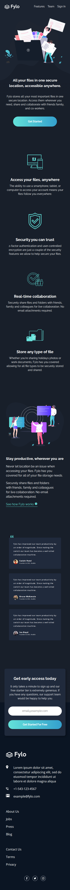
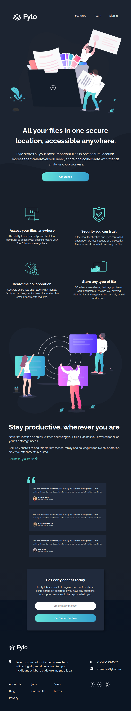
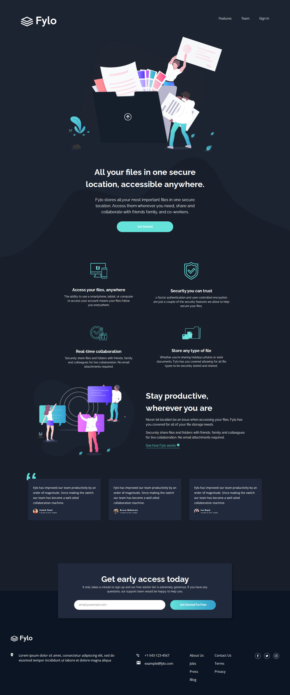

# Fylo Dark Theme Landing Page

A responsive landing page built as a solution to the [Fylo Dark Theme Landing Page challenge](https://www.frontendmentor.io/challenges/fylo-dark-theme-landing-page-5ca5f2d21e82137ec91a50fd) on Frontend Mentor.

The project focuses on responsive layout, reusable React components, form validation, accessibility, and automated testing.

## Table of Contents

- [Overview](#overview)
  - [The Challenge](#the-challenge)
  - [Screenshot](#screenshot)
  - [Links](#links)
- [My Process](#my-process)
  - [Built With](#built-with)
  - [Key Features](#key-features)
  - [What I Learned](#what-i-learned)
  - [Testing](#testing)
  - [CI/CD](#cicd)
  - [Continued Development](#continued-development)
  - [AI Collaboration](#ai-collaboration)
- [Author](#author)

## Overview

### The Challenge

The goal was to recreate the provided design and build a responsive landing page that adapts to different screen sizes and provides interactive states for its elements.

Users should be able to:

- View an optimized layout on mobile, tablet, and desktop devices.
- Interact with navigation links and other interactive elements.
- Enter an email address in the early access form and receive validation feedback.

### Screenshot

#### Fylo Dark Theme Landing Page - Mobie View



#### Fylo Dark Theme Landing Page - Tablet View



#### Fylo Dark Theme Landing Page - Desktop View



### Links

- **Live Site:** [View the deployed project](https://pgfylo-dark-theme-landing-page.netlify.app)

## My Process

### Built With

- Semantic HTML5
- CSS Modules
- CSS Grid and Flexbox
- Mobile-first responsive design
- JavaScript (ES6+)
- React
- Vite
- Vitest
- React Testing Library
- Git and GitHub
- GitHub Actions
- Netlify

### Key Features

- Responsive layout for mobile, tablet, and desktop screens.
- Reusable React components with a component-based architecture.
- CSS Modules for component-scoped styling.
- Email form with validation and conditional error rendering.
- Interactive navigation and links with appropriate hover states.
- Automated component tests.
- Continuous integration and deployment using GitHub Actions and Netlify.

### What I Learned

**Responsive design**

I practiced a mobile-first workflow and adapted the layout to larger screen sizes using CSS media queries, Flexbox, and Grid.

**Component architecture**

I improved my understanding of breaking a UI into reusable React components, passing data through props, and keeping component responsibilities clear.

**Form handling**

I worked with React state to manage form input and validation feedback, including conditionally rendering error messages.

**Accessibility**

I paid attention to semantic HTML, descriptive alternative text, and appropriate attributes for links and decorative images.

**Automated testing**

I practiced testing React components with Vitest and React Testing Library, focusing on user-visible behavior and interactions.

### Testing

The project includes automated component tests using Vitest and React Testing Library.

Tests cover:

- Footer contact links, logo navigation, and social links.
- Early access form validation and error handling.
- Logo navigation.
- Navigation links.
- Team and testimonial-related components.

Run the tests locally with:

```bash
pnpm test
```

### CI/CD

GitHub Actions automates the project's quality checks and deployment workflow.

The workflow includes:

- Dependency installation using pnpm.
- ESLint checks.
- Prettier formatting verification.
- Automated tests.
- Production build verification.
- Deployment to Netlify.

This workflow helps verify changes before they are delivered and keeps the deployed version synchronized with the main branch.

### Continued Development

In future projects, I want to continue improving my skills in:

- TypeScript and stronger type safety in React applications.
- More comprehensive component and end-to-end testing.
- Form validation and handling more complex user interactions.
- Frontend performance and accessibility.
- Full-stack development and API integration.

### AI Collaboration

I used ChatGPT as a learning and problem-solving assistant during development.

AI assistance supported:

- Debugging and understanding implementation issues.
- Discussing React patterns and CSS layout approaches.
- Reviewing accessibility considerations.
- Working through component testing and CI/CD configuration.

The project served as a practical learning exercise, with implementation decisions and code developed and verified as part of my own workflow.

## Author

- **GitHub:** [GrzybowskiPiotr GitHub profile](https://github.com/GrzybowskiPiotr/)
- **Frontend Mentor:** [Your Frontend Mentor profile](ADD_FRONTEND_MENTOR_PROFILE_URL)
